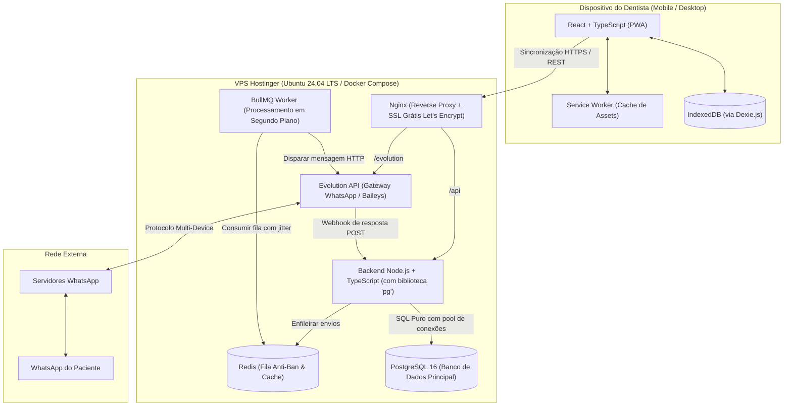
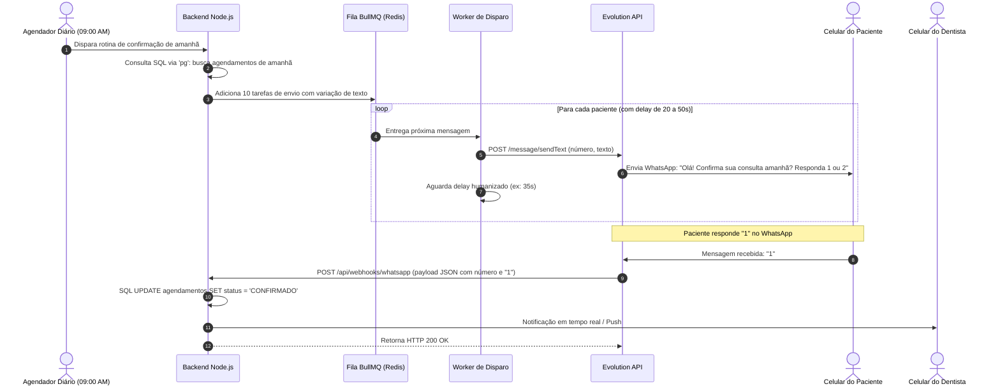

# Especificação de Arquitetura Técnica & Infraestrutura
## OdontoFlow — Sistema de Gestão Odontológica Mobile-First & Offline

---

### 1. Visão Geral da Arquitetura de Sistemas

A arquitetura do **OdontoFlow** foi projetada para combinar alta performance em dispositivos móveis (*Local-First*), operação offline resiliente e baixo custo operacional de infraestrutura (rodando integralmente em uma VPS básica).



---

### 2. Definição Detalhada da Stack Tecnológica

#### 2.1 Frontend & Site Vitrine (Hospedados na Mesma VPS via Nginx)
* **Aplicação OdontoFlow (App PWA):**
  * Desenvolvido em **React 18+ com TypeScript e Vite**.
  * O comando `vite build` gera arquivos estáticos (`index.html`, bundles JS/CSS) que são servidos diretamente pelo **Nginx** com cache agressivo e compressão Gzip/Brotli.
  * Consumo adicional de memória no servidor: **quase zero (< 10 MB)**.
* **Site Vitrine / Institucional do Consultório:**
  * Hospedado na mesma VPS, respondendo no domínio raiz (ex: `consultorio.com.br`).
  * Totalmente isolado do app (que roda no subdomínio `app.consultorio.com.br`).
  * Também servido estaticamente pelo Nginx via Virtual Hosts.

#### 2.2 Backend & Banco de Dados (Servidor)
* **Runtime:** Node.js (v20+ LTS) com **TypeScript**.
* **Framework HTTP:** **Express.js** (simples, consolidado, seguro e com ecossistema maduro).
* **Driver de Banco de Dados:** **`pg` (node-postgres)** com `Pool` de conexões.
  * Consultas escritas em **SQL puro**, com parametrização explícita (`$1, $2`) para segurança e controle fino de performance.
* **Banco de Dados Relacional:** **PostgreSQL 16**.
  * Índices compostos por `tenant_id` para garantir isolamento absoluto e alta velocidade quando o sistema virar SaaS multi-clínicas.

#### 2.3 Mensageria, Fila Anti-Ban e WhatsApp
* **Gateway WhatsApp:** **Evolution API** (open-source baseada em Baileys).
  * Executada em container Docker dedicado.
  * Conexão via escaneamento de QR Code diretamente no app.
  * Custo de mensagens: **R$ 0,00**.
* **Fila de Envio (Throttling / Jitter):** **BullMQ + Redis**.
  * Enfileira disparos automáticos para os pacientes do dia seguinte.
  * Aplica intervalo randômico humanizado de **20 a 50 segundos** entre cada mensagem com modelos dinâmicos de texto (*Spintax*).
* **Recepção de Respostas:** Webhook nativo apontando para o endpoint do backend Node.js (`POST /api/webhooks/whatsapp`).

---

### 3. Modelo de Infraestrutura & Consumo de Recursos (Hostinger KVM 1)

O sistema opera com um único arquivo `docker-compose.yml`, orquestrando todos os serviços em rede interna isolada:

| Serviço | Função | Consumo Médio de RAM |
| :--- | :--- | :--- |
| **Sistema Operacional (Linux Ubuntu)** | Kernel e serviços base | ~450 MB |
| **Nginx** | Proxy reverso e terminação SSL HTTPS | ~25 MB |
| **Backend Node.js + Worker** | API REST e processamento de filas | ~120 MB |
| **PostgreSQL 16** | Banco de dados relacional principal | ~150 MB |
| **Redis 7** | Armazenamento de filas do BullMQ | ~35 MB |
| **Evolution API** | Instância do WhatsApp Web headless | ~280 MB |
| **TOTAL ESTIMADO** | **Todos os serviços rodando juntos** | **~1.060 MB (~1.06 GB)** |

> **Margem de Segurança:** Na VPS básica da Hostinger (4 GB de RAM), o sistema consumirá cerca de **26% da memória**, deixando mais de **2,9 GB livres** para absorver picos de tráfego e crescimento da base.

---

### 4. Fluxo de Vida de uma Mensagem de Confirmação (Webhook Pipeline)



---

### 5. Esquema Inicial de Tabelas em SQL Puro (PostgreSQL)

Estrutura pronta para execução via biblioteca `pg`:

```sql
-- Habilita extensão para geração de UUID
CREATE EXTENSION IF NOT EXISTS "uuid-ossp";

-- 1. Tabela de Tenants (Clínicas / Consultórios)
CREATE TABLE tenants (
    id UUID PRIMARY KEY DEFAULT uuid_generate_v4(),
    name VARCHAR(255) NOT NULL,
    whatsapp_instance_name VARCHAR(100),
    is_active BOOLEAN DEFAULT TRUE,
    created_at TIMESTAMP WITH TIME ZONE DEFAULT CURRENT_TIMESTAMP
);

-- 2. Tabela de Pacientes
CREATE TABLE patients (
    id UUID PRIMARY KEY DEFAULT uuid_generate_v4(),
    tenant_id UUID NOT NULL REFERENCES tenants(id) ON DELETE CASCADE,
    name VARCHAR(255) NOT NULL,
    whatsapp VARCHAR(20) NOT NULL,
    notes TEXT,
    created_at TIMESTAMP WITH TIME ZONE DEFAULT CURRENT_TIMESTAMP
);
CREATE INDEX idx_patients_tenant_whatsapp ON patients(tenant_id, whatsapp);

-- 3. Tabela de Procedimentos
CREATE TABLE procedures (
    id UUID PRIMARY KEY DEFAULT uuid_generate_v4(),
    tenant_id UUID NOT NULL REFERENCES tenants(id) ON DELETE CASCADE,
    name VARCHAR(255) NOT NULL,
    default_duration_minutes INT NOT NULL DEFAULT 30,
    default_price NUMERIC(10, 2) NOT NULL DEFAULT 0.00,
    is_active BOOLEAN DEFAULT TRUE,
    created_at TIMESTAMP WITH TIME ZONE DEFAULT CURRENT_TIMESTAMP
);
CREATE INDEX idx_procedures_tenant ON procedures(tenant_id);

-- 4. Tabela de Agendamentos
CREATE TYPE appointment_status AS ENUM (
    'PENDING', 
    'CONFIRMED', 
    'RESCHEDULE_REQUESTED', 
    'MESSAGE_RECEIVED', 
    'COMPLETED', 
    'NO_SHOW', 
    'CANCELLED'
);

CREATE TABLE appointments (
    id UUID PRIMARY KEY DEFAULT uuid_generate_v4(),
    tenant_id UUID NOT NULL REFERENCES tenants(id) ON DELETE CASCADE,
    patient_id UUID NOT NULL REFERENCES patients(id),
    start_time TIMESTAMP WITH TIME ZONE NOT NULL,
    end_time TIMESTAMP WITH TIME ZONE NOT NULL,
    status appointment_status DEFAULT 'PENDING',
    total_charged NUMERIC(10, 2),
    notes TEXT,
    created_at TIMESTAMP WITH TIME ZONE DEFAULT CURRENT_TIMESTAMP,
    updated_at TIMESTAMP WITH TIME ZONE DEFAULT CURRENT_TIMESTAMP
);
CREATE INDEX idx_appointments_tenant_dates ON appointments(tenant_id, start_time, end_time);

-- 5. Itens do Agendamento (Múltiplos Procedimentos por consulta)
CREATE TABLE appointment_items (
    id UUID PRIMARY KEY DEFAULT uuid_generate_v4(),
    appointment_id UUID NOT NULL REFERENCES appointments(id) ON DELETE CASCADE,
    procedure_id UUID NOT NULL REFERENCES procedures(id),
    effective_price NUMERIC(10, 2) NOT NULL,
    duration_minutes INT NOT NULL
);

-- 6. Transações Financeiras (Caixa Simples & Contas a Receber)
CREATE TYPE transaction_type AS ENUM ('INCOME', 'EXPENSE');
CREATE TYPE transaction_status AS ENUM ('PAID', 'PENDING');
CREATE TYPE payment_method AS ENUM ('PIX', 'CREDIT_CARD', 'DEBIT_CARD', 'CASH', 'BOLETO');

CREATE TABLE financial_transactions (
    id UUID PRIMARY KEY DEFAULT uuid_generate_v4(),
    tenant_id UUID NOT NULL REFERENCES tenants(id) ON DELETE CASCADE,
    appointment_id UUID REFERENCES appointments(id) ON DELETE SET NULL,
    type transaction_type NOT NULL,
    category VARCHAR(100) NOT NULL, -- Ex: 'Atendimento', 'Aluguel', 'Material Dental'
    description VARCHAR(255),
    amount NUMERIC(10, 2) NOT NULL,
    payment_method payment_method,
    status transaction_status DEFAULT 'PAID',
    due_date DATE NOT NULL,
    payment_date DATE,
    installment_number INT DEFAULT 1,
    total_installments INT DEFAULT 1,
    created_at TIMESTAMP WITH TIME ZONE DEFAULT CURRENT_TIMESTAMP
);
CREATE INDEX idx_transactions_tenant_dates ON financial_transactions(tenant_id, due_date, status);
```

---

### 6. Isolamento e Segurança Multi-Tenant

Para garantir que uma clínica nunca acesse dados de outra (preparação de SaaS):
1. **Camada de Aplicação:** Toda query executada com `pg` inclui obrigatoriamente a cláusula `WHERE tenant_id = $1`.
2. **Autenticação:** Tokens JWT assinado contendo o `tenant_id` e `user_id` no payload.
3. **Isolamento no WhatsApp:** A Evolution API permite criar instâncias isoladas (`/instance/create`) nomeadas com o identificador do tenant, garantindo que cada clínica tenha seu próprio QR Code e sessão.
