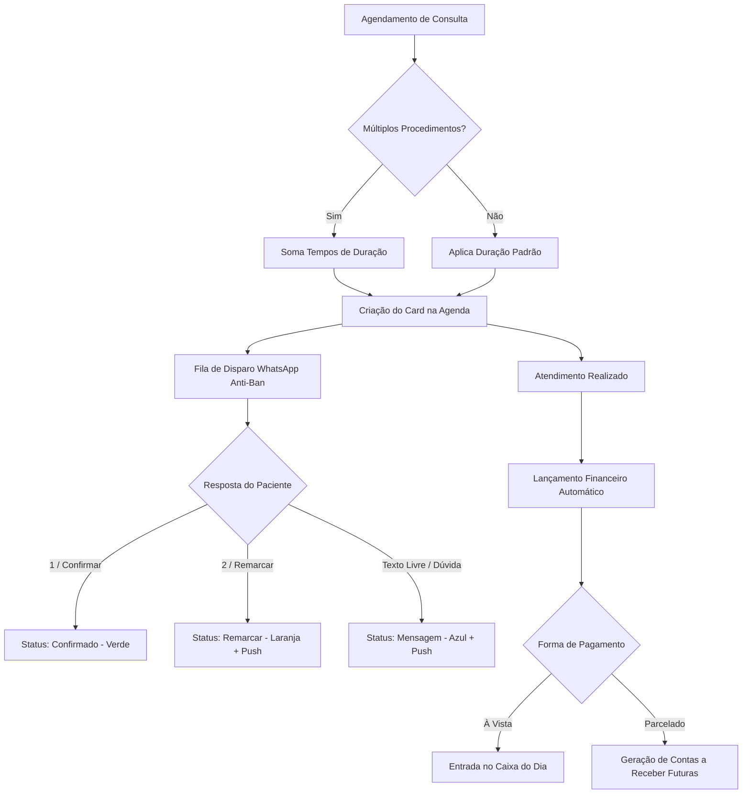
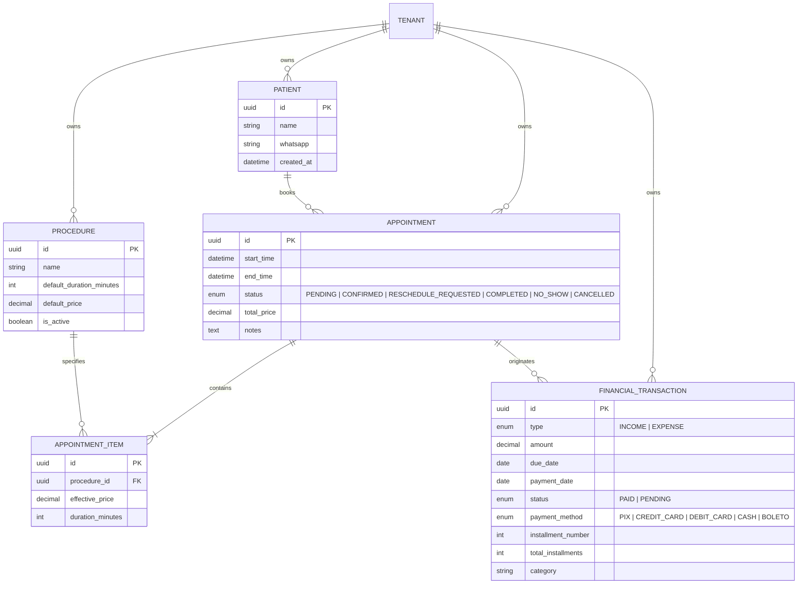

# Product Requirements Document (PRD)
## OdontoFlow — Gestão Ágil de Agenda, Confirmações e Caixa para Consultórios Odontológicos

---

### 1. Visão Geral do Produto e Problema de Negócio

#### 1.1 Contexto e Justificativa
Consultórios odontológicos particulares solo (onde o próprio dentista gerencia agendamentos, atendimento e finanças) sofrem com três dores críticas:
1. **Perda de faturamento por *No-Show* (faltas e esquecimentos):** A ausência de confirmações automáticas gera ociosidade na cadeira clínica.
2. **Fricção operacional extrema:** Softwares tradicionais de gestão odontológica são burocráticos, lentos, pesados e focados em desktop, afastando o dentista que precisa registrar consultas em poucos segundos no celular.
3. **Falta de previsibilidade financeira:** Dificuldade em controlar recebimentos parcelados e identificar quais procedimentos realmente sustentam a margem do consultório.

#### 1.2 Proposta de Valor
Um sistema **Mobile-First**, **Local-First (Offline)** e de **fricção zero**, que permite lançar agendamentos em menos de 10 segundos, automatiza confirmações humanizadas via WhatsApp sem risco de banimento e converte consultas em lançamentos financeiros estruturados com suporte a parcelamentos.

---

### 2. Personas e Cenários de Uso

#### 2.1 Persona Principal: "O Dentista-Operador"
* **Perfil:** Cirurgião-dentista atuando em consultório particular próprio, sem recepcionista dedicada ou com atendimento direto via WhatsApp.
* **Comportamento:** Atende pacientes com luvas/máscara, faz pausas curtas de 3 a 5 minutos entre atendimentos, utiliza o smartphone pessoal para conversar com clientes e checar horários.
* **Necessidades:**
  * Velocidade máxima de entrada de dados (poucos toques).
  * Confiabilidade da agenda mesmo em salas com Wi-Fi/4G oscilante.
  * Automação de lembretes para não ter que enviar mensagens manuais uma a uma.

---

### 3. Arquitetura e Requisitos Não-Funcionais

#### 3.1 PWA & Local-First (Offline por Padrão)
* **Tecnologia de Interface:** Progressive Web App (PWA) instalável no smartphone (iOS e Android) e no desktop.
* **Armazenamento Local:** Banco de dados client-side (IndexedDB / Dexie.js) como fonte imediata de leitura e escrita.
* **Janela Ativa de Cache:** 
  * Catálogo completo de pacientes e procedimentos.
  * Histórico de agendamentos dos últimos 90 dias + 100% dos agendamentos futuros.
  * Transações financeiras do ano corrente.
* **Resolução de Conflitos:** Estratégia *Last-Write-Wins* baseada em timestamp, adequada para perfil de operador único.
* **Fila de Sincronização (Sync Queue):** Operações realizadas offline são enfileiradas e despachadas para o backend assim que a conectividade for restabelecida.

#### 3.2 SaaS Multi-Tenant (Preparação para Expansão)
* Isolamento lógico de dados por organização (`tenant_id` em todas as tabelas).
* Suporte nativo à futura adição de múltiplos profissionais por clínica.

---

### 4. Especificação Funcional (Épicos do MVP)

---

#### ÉPICO 1: Gestão Dinâmica de Agenda e Clientes

* **US1.1 - Grid Temporal Flexível & Expediente Customizável:**
  * Resolução visual em blocos de 15 minutos (permite agendamentos de 15, 30, 45, 60, 75, 90+ min).
  * O dentista pode configurar livremente o horário de funcionamento de cada dia da semana (ex: 08:00 às 21:00 sem almoço, ou com intervalo customizado).
  * Visualização diária e semanal com rolagem vertical suave no mobile.
* **US1.2 - Cadastro On-The-Fly de Pacientes e Procedimentos:**
  * O dentista pode digitar o nome de um novo paciente diretamente no campo de busca do agendamento. Se não existir, basta preencher o WhatsApp em um micro-modal inline e salvar.
  * Se o procedimento desejado não estiver na lista, o modal permite criá-lo instantaneamente (Nome, Duração em minutos, Preço base) sem sair do fluxo.
* **US1.3 - Agendamento Fora do Expediente / Encaixe com Soft-Warning:**
  * Caso o dentista tente marcar uma consulta fora do horário regular (ex: após as 18:00 ou durante o almoço), o app **nunca bloqueia de forma brusca**.
  * O sistema exibe um aviso amigável: *"⚠️ Este horário está fora do expediente regular (encerra às 18:00). Deseja confirmar este agendamento como encaixe extraordinário?"*
  * Se o dentista confirmar, o agendamento é salvo normalmente e ganha um selo discreto de *"⚡ Encaixe"* na grade.
* **US1.4 - Múltiplos Procedimentos no Mesmo Horário:**
  * Permite associar 1 ou mais procedimentos a um único agendamento.
  * O sistema soma automaticamente a duração estimada de cada procedimento selecionado para determinar o horário de término na grade.
* **US1.5 - Ação Inteligente "Finalizar & Agendar Retorno" (com Detecção de Conflito):**
  * Ao clicar nos atalhos (*"Daqui a 15 dias"*, *"Daqui a 30 dias"*, *"Daqui a 6 meses"*), o sistema calcula a data alvo e avalia a disponibilidade da grade para o mesmo horário:
    * **Cenário Livre:** Se o horário estiver livre, o sistema já sugere o slot e permite confirmar com 1 toque.
    * **Cenário Conflito / Ocupado / Fim de Semana:** Se o horário estiver ocupado ou fora do expediente, o sistema **não gera erro nem sobreposição**. Ele exibe imediatamente uma "Gaveta de Sugestões Inteligentes" com os **3 horários vagos mais próximos** (ex: *"14:00 (Ocupado) ➔ Sugestões: Hoje às 15:00, ou Dia seguinte às 14:00"*), permitindo que o dentista selecione uma alternativa sem precisar navegar manualmente pelo calendário.
* **US1.6 - Gestão de No-Show (Faltas):**
  * Botão de 1 toque no card: *"Paciente Faltou"*. Libera a cadeira, mantém o registro de histórico e alimenta as métricas de absenteísmo.

---

#### ÉPICO 2: Motor de Automação WhatsApp Anti-Ban

* **US2.1 - Conexão por QR Code:**
  * Pareamento direto com o número de WhatsApp pessoal/comercial do dentista através de leitura de QR Code na tela de configurações.
* **US2.2 - Motor de Disparo Humanizado (Anti-Ban / Throttling):**
  * As mensagens de confirmação são disparadas automaticamente para os pacientes do dia seguinte dentro de uma janela parametrizada (ex: entre 09:00 e 11:00).
  * Intervalo randômico entre envios (jitter de 20 a 50 segundos entre cada mensagem).
  * Variação dinâmica de saudações e modelos de texto (Spintax) para evitar hashes de mensagem idênticos.
* **US2.3 - Captura de Respostas e Ciclo de Confirmação:**
  * **Confirmação:** Reconhecimento de `1`, *"Sim"*, *"Confirmado"* ou reação 👍 -> Altera status para **Confirmado (Verde)** e envia mensagem de confirmação.
  * **Remarcação:** Reconhecimento de `2`, *"Não posso"*, *"Remarcar"* -> Altera status para **Atenção/Remarcar (Laranja)** e emite alerta.
  * **Exceção (Texto livre / Áudio):** Altera status para **Mensagem Recebida (Azul)** e convida o dentista a interagir.
* **US2.4 - Sistema de Alertas em Tempo Real:**
  * Disparo de Push Notifications no dispositivo móvel e badges visuais na agenda em caso de remarcação ou mensagens recebidas.

---

#### ÉPICO 3: Gestão Financeira Simplificada ("Caixa de Bolso")

* **US3.1 - Conclusão de Consulta com Lançamento Automático:**
  * Ao marcar a consulta como realizada, abre-se o modal de cobrança pré-preenchido com os procedimentos executados.
* **US3.2 - Edição Flexível de Preços e Rateio de Desconto:**
  * **Edição Individual (Sempre Ativa):** Em qualquer cenário (1 único procedimento ou múltiplos procedimentos), o dentista tem total liberdade para clicar e editar o valor unitário de qualquer procedimento na tela de cobrança.
  * **Desconto Global Automático:** Caso o dentista prefira apenas alterar o "Valor Total Final", o sistema calcula o percentual de abatimento e aplica o rateio proporcional em cada item automaticamente para preservar a integridade do relatório de lucratividade.
* **US3.3 - Suporte Avançado a Parcelamento e Entrada:**
  * **Entrada Diferenciada:** Suporte a valor de entrada diferente das demais parcelas (Ex: Total R$ 1.500 ➔ Entrada de R$ 300 hoje + 3x de R$ 400).
  * **Flexibilidade na Data da 1ª Parcela:** O dentista pode definir se a primeira parcela vence hoje, no mês atual ou em uma data futura personalizada (ex: daqui a 45 dias).
  * **Projeção Automática de Parcelas:** Ao definir ou alterar a data-base da 1ª parcela, o sistema recalcula automaticamente as datas de vencimento das parcelas subsequentes (intervalo de 30 dias a partir da data informada).
* **US3.4 - Lançamento Rápido de Despesas:**
  * Registro de saídas em menos de 10 segundos: Valor, Categoria simples (Material Dentário, Aluguel, Prótese, Outros) e Data.

---

#### ÉPICO 4: Relatórios e Inteligência do Consultório

* **US4.1 - Indicador de No-Show:**
  * Percentual de faltas sobre o total de agendamentos no período selecionado, com impacto financeiro estimado da ociosidade.
* **US4.2 - DRE Simplificado:**
  * Entradas Realizadas (-) Despesas Pagas (=) **Lucro Líquido do Período**.
  * Previsão de Entradas dos próximos 30/60/90 dias com base nas parcelas a receber.
* **US4.3 - Desempenho por Procedimento:**
  * Gráfico de procedimentos mais realizados vs procedimentos de maior faturamento acumulado.
* **US4.4 - Lista de Pacientes Inativos (Reativação):**
  * Listagem de pacientes cujo último agendamento ocorreu há mais de 6 meses, com botão direto de atalho para iniciar conversa no WhatsApp sugerindo revisão/limpeza preventiva.

---

### 5. Modelo de Dados Conceitual

---

### 6. Fora do Escopo Inicial (Post-MVP)

* Prontuário clínico digital detalhado e odontograma interativo 3D.
* Emissão automatizada de notas fiscais (NFS-e) e integração bancária direta (Open Finance).
* Link público de autoagendamento para pacientes.
* Sistema multi-sala ou divisão de comissão entre múltiplos profissionais.
