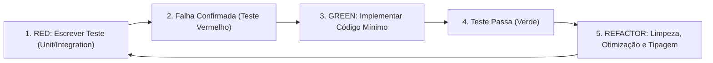

# Roadmap de Desenvolvimento Orientado a Testes (TDD Roadmap)
## OdontoFlow — Execução Ágil com TDD (Red-Green-Refactor)

---

### 1. Diretriz Metodológica do Projeto (TDD Rigoroso)

Para garantir robustez, ausência de regressões e código enxuto, o desenvolvimento seguirá estritamente o ciclo **TDD**:

#### Regras de Ouro do Nosso TDD:
1. **Nenhum código de negócio é escrito antes do seu teste.**
2. **Todo caso de uso deve nascer com testes do Caminho Feliz (Happy Path) e Testes de Borda (Edge Cases).**
3. **Os testes devem rodar em menos de 5 segundos no modo *watch* (utilizando Vitest + pg-mem + fake-indexeddb).**

---

### 2. Cronograma de Fases e Sprints com Especificação de Testes

---

#### SPRINT 1: Core de Domínio, Validações e Agenda Local-First (Front)
> **Objetivo:** Garantir a matemática de horários, regras de conflito e persistência local offline antes de qualquer layout visual.

##### 1.1 Testes Unitários a Criar Antes do Código (`domain.spec.ts`)
* [ ] **Cálculo de Duração Múltipla:** Testar soma de tempos de 1, 2 e 3+ procedimentos (ex: 30min + 45min = 75min -> término às 15:15 para início às 14:00).
* [ ] **Normalização de WhatsApp Brasileiro:** Testar formatos variados (`11999998888`, `(11) 99999-8888`, `+55 11 99999-8888`, `1188887777` sem 9) e garantir saída padronizada `5511999998888`.
* [ ] **Algoritmo de Retorno Inteligente:** Testar cálculo de datas para 15, 30 e 180 dias.
* [ ] **Algoritmo de Sugestão de Horários Vagos:** Simular agenda com conflito no horário exato e verificar se a função retorna exatamente as **3 opções livres mais próximas** (respeitando horário comercial e ignorando fins de semana).
* [ ] **Configuração Flexível de Expediente:** Testar horários de expediente estendidos (ex: 08:00 às 21:00) e dias sem intervalo de almoço (`break_start_time = null`).
* [ ] **Agendamento Extraordinário / Encaixe (Soft Warning):** Testar tentativa de agendamento às 19:30 quando o expediente encerra às 18:00:
  * Sem flag de confirmação: retorna aviso/alerta `outside_business_hours: true`.
  * Com flag `confirm_overtime: true`: persiste com sucesso e marca como encaixe extraordinário.

##### 1.2 Testes de Edge Cases (Casos de Erro / Limite)
* [ ] **Edge Case 1.1:** Procedimento com duração de 0 ou valor negativo (deve disparar erro de validação).
* [ ] **Edge Case 1.2:** Tentativa de agendamento em horário retroativo (data/hora passada).
* [ ] **Edge Case 1.3:** Agendamento que ultrapassa o horário de fechamento do consultório (ex: agendar 2h de canal às 18:30 quando o consultório fecha às 19:00).
* [ ] **Edge Case 1.4:** Paciente com nome contendo apenas espaços em branco ou caracteres especiais.

##### 1.3 Testes de Integração com IndexedDB Local (`dexie.spec.ts` via `fake-indexeddb`)
* [ ] Gravação e leitura de agendamento em menos de 5ms.
* [ ] Operação offline: registrar agendamento com flag `sync_status = 'PENDING'` na fila local.
* [ ] Consulta reativa (*Live Query*): verificar se a lista de agendamentos do dia emite novo evento ao inserir registro.

---

#### SPRINT 2: Backend Express.js, Isolamento Multi-Tenant e SQL com `pg`
> **Objetivo:** Construir as rotas da API REST e queries em SQL puro com total garantia de isolamento entre consultórios.

##### 2.1 Testes de Integração de API a Criar Antes (`api.spec.ts` via Supertest + pg-mem)
* [ ] **Autenticação & Tenant Context:** Requisições sem header de autorização retornam `401 Unauthorized`.
* [ ] **Isolamento de Tenant (Multi-Tenant Test):**
  * Criar Tenant A e Tenant B.
  * Inserir paciente no Tenant A.
  * Fazer query `GET /patients` autenticado como Tenant B e verificar que o retorno é `[]` (vazio).
* [ ] **CRUD de Pacientes e Procedimentos:** Criação, listagem e atualização via queries SQL puras parametrizadas (`$1, $2`).
* [ ] **Endpoint de Agendamento:** `POST /appointments` persistindo nas tabelas `appointments` e `appointment_items` dentro de uma transação SQL (`BEGIN ... COMMIT`).

##### 2.2 Testes de Edge Cases
* [ ] **Edge Case 2.1 - Concorrência (Double Booking):** Duas requisições simultâneas tentando agendar no mesmo minuto. O banco deve rejeitar a segunda com erro de conflito de agenda (`409 Conflict`).
* [ ] **Edge Case 2.2 - Injeção SQL:** Enviar payload malicioso no campo de busca de paciente (ex: `' OR '1'='1`). A query parametrizada deve tratar como string literal sem vazar dados.
* [ ] **Edge Case 2.3 - Falha de Transação:** Simular erro ao inserir em `appointment_items`. O sistema deve executar `ROLLBACK` e não deixar registro órfão em `appointments`.
* [ ] **Edge Case 2.4 - Sincronização em Lote (Sync Batch):** PWA envia 5 agendamentos criados offline. Todos devem ser persistidos com idempotência (sem duplicar se já existirem).

---

#### SPRINT 3: Motor WhatsApp, Filas BullMQ e Webhook Anti-Ban
> **Objetivo:** Testar toda a mensageria de confirmação, temporizadores e captura de respostas sem disparar mensagens reais.

##### 3.1 Testes Unitários de Mensageria (`whatsapp.spec.ts`)
* [ ] **Parser de Respostas do Paciente:**
  * Entradas que devem classificar como **CONFIRMADO:** `"1"`, `"1."`, `"Sim"`, `"sim"`, `"confirmar"`, `"CONFIRMADO"`, `"👍"`, `"ok"`.
  * Entradas que devem classificar como **REMARCAR:** `"2"`, `"Não posso"`, `"remarcar"`, `"preciso trocar"`, `"cancela"`.
  * Entradas que devem classificar como **MENSAGEM / DÚVIDA:** `"posso chegar 15 min atrasado?"`, áudio, imagem ou texto livre.
* [ ] **Gerador Spintax (Anti-Ban):** Testar se a função de montagem de mensagem gera variações diferentes de saudação para 10 execuções consecutivas.

##### 3.2 Testes de Filas & Throttling (`queue.spec.ts` via `ioredis-mock`)
* [ ] **Intervalo Humanizado:** Enfileirar 5 mensagens e verificar se o delay programado entre as tarefas fica estritamente dentro da faixa de **20 a 50 segundos**.
* [ ] **Retry com Backoff:** Simular queda de conexão HTTP com a Evolution API. A tarefa deve falhar e entrar em retry com espera progressiva de 2 minutos, sem travar as próximas tarefas.

##### 3.3 Testes do Webhook (`webhook.spec.ts`)
* [ ] Enviar payload de webhook simulado da Evolution API com `"1"` para o endpoint `POST /api/webhooks/whatsapp`.
* [ ] Verificar se o status do agendamento no PostgreSQL mudou para `'CONFIRMED'` e a coluna `updated_at` foi atualizada.
* [ ] **Edge Case 3.1:** Webhook recebe resposta de um número de WhatsApp que não possui nenhum agendamento pendente (deve responder `200 OK` silenciosamente e não quebrar o serviço).
* [ ] **Edge Case 3.2:** Paciente responde `"1"` para uma consulta que já foi concluída ou cancelada há dias. O sistema não deve reverter o status.

---

#### SPRINT 4: Checkout do Dentista, Caixa e Parcelamento com Entrada
> **Objetivo:** Blindar a lógica financeira, os cálculos de dízimas de rateio e as projeções de vencimento de parcelas.

##### 4.1 Testes da Lógica Financeira (`financial.spec.ts`)
* [ ] **Rateio Proporcional de Desconto:**
  * Procedimento A: R$ 200 | Procedimento B: R$ 300 (Total: R$ 500).
  * Dentista cobra R$ 450 (10% de desconto).
  * Resultado esperado: Procedimento A = R$ 180,00 | Procedimento B = R$ 270,00.
* [ ] **Rateio com Dízima Periódica (O Teste do Centavo):**
  * 3 procedimentos de R$ 100 cada (Total: R$ 300).
  * Dentista aplica desconto e cobra R$ 200 (desconto de R$ 100 / 33.33%).
  * A soma dos itens rateados **deve fechar rigorosamente em R$ 200,00**, ajustando o centavo excedente no último item para evitar erro contábil.
* [ ] **Geração de Parcelas com Entrada:**
  * Total R$ 1.500 | Entrada R$ 300 (Hoje) | 3 parcelas de R$ 400.
  * Verificar geração de 4 transações no banco: 1 `PAID` (hoje) e 3 `PENDING` (datas futuras).
* [ ] **Projeção de Datas das Parcelas:**
  * 1ª parcela definida para `15/Novembro`.
  * Parcela 2 deve ser gerada para `15/Dezembro`.
  * Parcela 3 deve ser gerada para `15/Janeiro`.

##### 4.2 Testes de Edge Cases & Auditoria Financeira
* [ ] **Edge Case 4.1 - Virada de Mês / Dias 29, 30 e 31:** 1ª parcela em `31 de Janeiro`. A 2ª parcela não pode quebrar a data (deve cair em `28 de Fevereiro`).
* [ ] **Edge Case 4.2:** Valor da entrada informado maior do que o valor total cobrado (deve retornar erro de validação).
* [ ] **Edge Case 4.3:** Lançamento de despesa com valor R$ 0,00 ou sem categoria informada.
* [ ] **Edge Case 4.4 - Precisão Monetária (O Bug do Ponto Flutuante em JS):** Garantir que nenhuma operação de divisão/rateio gere dízimas flutuantes (ex: `0.30000000000000004`). Toda a matemática interna deve rodar em centavos inteiros antes da persistência.
* [ ] **Edge Case 4.5 - Quitação Antecipada de Parcelas:** Paciente que parcelou em 3x decide pagar a 2ª e a 3ª parcelas juntas no segundo mês. O sistema deve permitir liquidar múltiplas parcelas simultaneamente com 1 clique.

---

#### SPRINT 5: Relatórios, Métricas Gerenciais e E2E
> **Objetivo:** Validar os relatórios analíticos em SQL e testar a jornada completa do app em navegadores móveis.

##### 5.1 Testes de Relatórios Analíticos (`analytics.spec.ts` via SQL puro)
* [ ] **Cálculo da Taxa de No-Show:** Total de 10 agendamentos (8 concluídos, 2 faltas) = Taxa exata de 20%.
* [ ] **DRE Simplificado:** Soma exata de `INCOME` com status `PAID` (-) Soma de `EXPENSE` com status `PAID` (=) Lucro Líquido.
* [ ] **Relatório de Procedimentos mais Lucrativos:** Agrupamento por procedimento somando o `effective_price` (com descontos aplicados), ordenado pelo maior faturamento.
* [ ] **Filtro de Pacientes Inativos (Reativação):** Paciente com último atendimento há 185 dias deve constar na lista; paciente atendido há 170 dias não deve constar.

##### 5.2 Testes de Edge Cases
* [ ] **Edge Case 5.1 - Divisão por Zero:** Consultório recém-criado sem nenhum agendamento histórico ao abrir a tela de métricas (taxa de no-show deve retornar `0%` sem disparar erro `NaN` ou `DivisionByZero`).

##### 5.3 Testes End-to-End (`e2e/workflow.spec.ts` via Playwright Mobile)
* [ ] Simular viewport de smartphone (iPhone 14 / Pixel 7).
* [ ] Testar fluxo: Abrir tela da agenda ➔ Tocar no horário 14:00 ➔ Preencher paciente e procedimento ➔ Salvar ➔ Validar card verde/amarelo na tela.
* [ ] Simular modo offline (desativar rede do browser) ➔ Criar agendamento ➔ Reativar rede ➔ Validar sincronização.

---

### 3. Matriz de Testes de Integridade Crítica (Gotchas de Produção)

Estes testes complementares devem ser criados transversalmente para garantir que o sistema não falhe em situações reais de produção:

| Ponto Cego Auditado | O que o Teste Valida | Onde Testar |
| :--- | :--- | :--- |
| **Fuso Horário (Timezone / UTC-3)** | Agendamentos criados próximos da meia-noite (23:30) não mudam de dia no banco ou na exibição da agenda. Queries diárias usam `AT TIME ZONE 'America/Sao_Paulo'`. | `domain.spec.ts` & `api.spec.ts` |
| **Queda de Conexão do WhatsApp** | Se a sessão com a Evolution API for desfeita (`CONNECTION_LOST`), a fila BullMQ **pausa automaticamente** (evitando erros em cascata) e um webhook altera o badge para vermelho. | `whatsapp.spec.ts` & `queue.spec.ts` |
| **Máquina de Estados & Imutabilidade** | Paciente que confirmou pode remarcar (`CONFIRMED` ➔ `RESCHEDULE_REQUESTED`). Mas se a consulta já foi concluída (`COMPLETED`), nenhuma mensagem externa pode alterar o status. | `domain.spec.ts` |
| **Exclusão Segura (Soft Delete)** | Excluir paciente não remove agendamentos passados ou transações financeiras. O paciente ganha `is_active = FALSE` e os relatórios financeiros continuam intactos. | `api.spec.ts` |

