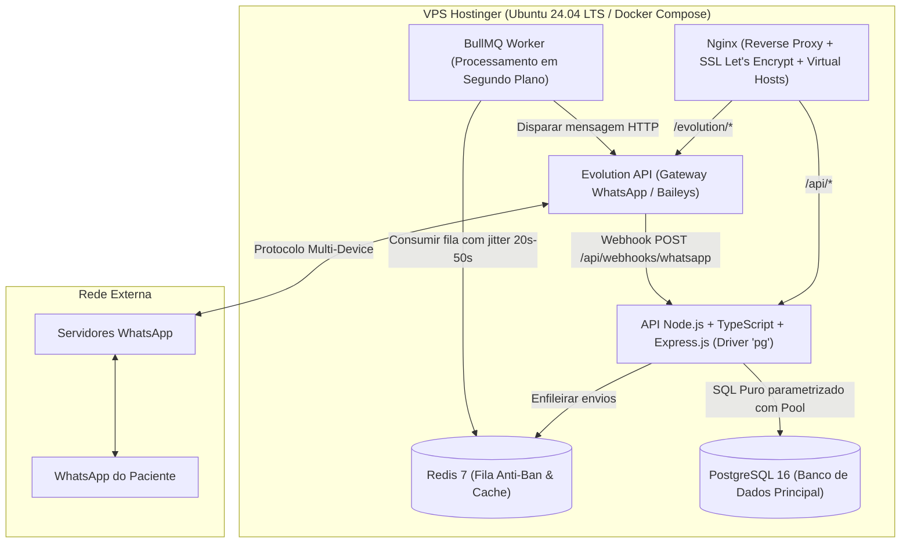
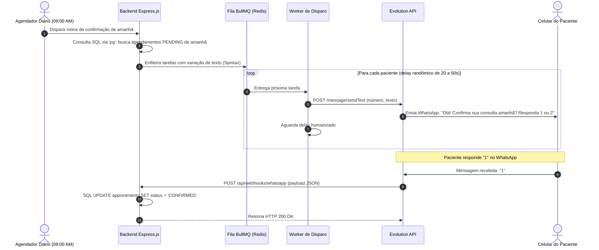

# Especificação de Arquitetura Técnica — Back-end & Infraestrutura
## OdontoFlow — Servidor API REST, Banco PostgreSQL, Filas e Gateway WhatsApp

---

### 1. Visão Geral da Arquitetura do Back-end

O back-end do **OdontoFlow** é responsável pela persistência centralizada no PostgreSQL, isolamento multi-tenant, sincronização com os dispositivos móveis, orquestração da fila anti-ban de mensagens no Redis e comunicação com a Evolution API via Webhooks.



---

### 2. Stack Tecnológica do Back-end

#### 2.1 Runtime, API & Banco de Dados
* **Runtime:** Node.js (v20+ LTS) com **TypeScript**.
* **Framework HTTP:** **Express.js** (arquitetura em camadas: Routes ➔ Controllers ➔ Services/UseCases ➔ Repositories SQL).
* **Contrato Compartilhado:** Importação direta do pacote `@odontoflow/shared` do Monorepo.
* **Driver de Banco de Dados:** **`pg` (node-postgres)** com `Pool` de conexões.
  * Consultas escritas em **SQL puro**, com parametrização estrita (`$1, $2`) para máxima performance, clareza e proteção total contra *SQL Injection*.
* **Banco de Dados Relacional:** **PostgreSQL 16**.
  * Fuso horário padronizado em `UTC` no armazenamento (`TIMESTAMP WITH TIME ZONE`), com conversão explícita `AT TIME ZONE 'America/Sao_Paulo'` nas consultas diárias e relatórios.

#### 2.2 Mensageria, Fila Anti-Ban e WhatsApp
* **Gateway WhatsApp:** **Evolution API** (open-source baseada em Baileys) rodando em container Docker dedicado.
* **Fila de Envio (Throttling / Jitter):** **BullMQ + Redis**.
  * Enfileira disparos automáticos para os pacientes do dia seguinte dentro da janela comercial configurada.
  * Aplica intervalo randômico humanizado de **20 a 50 segundos** entre cada mensagem com modelos dinâmicos de texto (*Spintax*).
  * Pausa automaticamente a fila caso receba evento de desconexão da sessão do WhatsApp (`CONNECTION_LOST`).
* **Recepção de Respostas:** Webhook nativo apontando para `POST /api/webhooks/whatsapp`.

#### 2.3 Stack de Testes Automatizados do Back-end (TDD)
* **Test Runner:** **Vitest**.
* **Testes de Rotas HTTP:** **Supertest** acoplado à instância do Express.js.
* **Testes de Banco SQL (`pg`):**
  * **pg-mem:** Banco PostgreSQL em memória para testes unitários instantâneos de repositórios e regras.
  * **PostgreSQL de Testes (Docker):** Banco real para testes de transações (`BEGIN ... COMMIT / ROLLBACK`), concorrência e constraints.
* **Mocks de Infraestrutura:**
  * **ioredis-mock:** Para testar o enfileiramento e delays do BullMQ.
  * **MSW / Nock:** Para simular respostas e falhas HTTP da Evolution API.

---

### 3. Dimensionamento na VPS (Hostinger KVM 1 — 4 GB RAM)

Todos os serviços rodam na mesma VPS via `docker-compose.yml`, além de o **Nginx** servir os arquivos estáticos do Front-end PWA (`app.consultorio.com.br`) e do Site Vitrine (`consultorio.com.br`):

| Serviço | Função | Consumo Médio de RAM |
| :--- | :--- | :--- |
| **Sistema Operacional (Ubuntu LTS)** | Kernel e serviços base | ~450 MB |
| **Nginx** | Proxy reverso, SSL, Front PWA estático e Site Vitrine | ~25 MB |
| **Backend Node.js (Express + Worker)** | API REST e processamento de filas BullMQ | ~120 MB |
| **PostgreSQL 16** | Banco de dados relacional principal | ~150 MB |
| **Redis 7** | Armazenamento de filas do BullMQ | ~35 MB |
| **Evolution API** | Instância do WhatsApp Web headless | ~280 MB |
| **TOTAL ESTIMADO** | **Todos os serviços rodando juntos** | **~1.060 MB (~1.06 GB)** |

---

### 4. Fluxo de Vida da Confirmação Automática (Webhook Pipeline)



---

### 5. Esquema Completo de Tabelas em SQL Puro (PostgreSQL DDL)

```sql
-- Habilita extensão para geração de UUID
CREATE EXTENSION IF NOT EXISTS "uuid-ossp";

-- 1. Tabela de Tenants (Clínicas / Consultórios)
CREATE TABLE tenants (
    id UUID PRIMARY KEY DEFAULT uuid_generate_v4(),
    name VARCHAR(255) NOT NULL,
    whatsapp_instance_name VARCHAR(100),
    whatsapp_connected BOOLEAN DEFAULT FALSE,
    is_active BOOLEAN DEFAULT TRUE,
    created_at TIMESTAMP WITH TIME ZONE DEFAULT CURRENT_TIMESTAMP
);

-- 2. Tabela de Pacientes (com Soft Delete is_active)
CREATE TABLE patients (
    id UUID PRIMARY KEY DEFAULT uuid_generate_v4(),
    tenant_id UUID NOT NULL REFERENCES tenants(id) ON DELETE CASCADE,
    name VARCHAR(255) NOT NULL,
    whatsapp VARCHAR(20) NOT NULL,
    notes TEXT,
    is_active BOOLEAN DEFAULT TRUE,
    created_at TIMESTAMP WITH TIME ZONE DEFAULT CURRENT_TIMESTAMP,
    updated_at TIMESTAMP WITH TIME ZONE DEFAULT CURRENT_TIMESTAMP
);
CREATE INDEX idx_patients_tenant_whatsapp ON patients(tenant_id, whatsapp);
CREATE INDEX idx_patients_tenant_active ON patients(tenant_id, is_active);

-- 3. Tabela de Procedimentos
CREATE TABLE procedures (
    id UUID PRIMARY KEY DEFAULT uuid_generate_v4(),
    tenant_id UUID NOT NULL REFERENCES tenants(id) ON DELETE CASCADE,
    name VARCHAR(255) NOT NULL,
    default_duration_minutes INT NOT NULL DEFAULT 30 CHECK (default_duration_minutes > 0),
    default_price_cents INT NOT NULL DEFAULT 0 CHECK (default_price_cents >= 0),
    is_active BOOLEAN DEFAULT TRUE,
    created_at TIMESTAMP WITH TIME ZONE DEFAULT CURRENT_TIMESTAMP
);
CREATE INDEX idx_procedures_tenant ON procedures(tenant_id);

-- 4. Tabela de Agendamentos
CREATE TYPE appointment_status AS ENUM (
    'PENDING', 
    'CONFIRMED', 
    'RESCHEDULE_REQUESTED', 
    'MESSAGE_RECEIVED', 
    'COMPLETED', 
    'NO_SHOW', 
    'CANCELLED'
);

CREATE TABLE appointments (
    id UUID PRIMARY KEY DEFAULT uuid_generate_v4(),
    tenant_id UUID NOT NULL REFERENCES tenants(id) ON DELETE CASCADE,
    patient_id UUID NOT NULL REFERENCES patients(id),
    start_time TIMESTAMP WITH TIME ZONE NOT NULL,
    end_time TIMESTAMP WITH TIME ZONE NOT NULL,
    status appointment_status DEFAULT 'PENDING',
    is_overtime BOOLEAN DEFAULT FALSE, -- Flag para encaixe fora do expediente
    total_charged_cents INT,           -- Armazenado em centavos inteiros para precisão contábil
    notes TEXT,
    created_at TIMESTAMP WITH TIME ZONE DEFAULT CURRENT_TIMESTAMP,
    updated_at TIMESTAMP WITH TIME ZONE DEFAULT CURRENT_TIMESTAMP
);
CREATE INDEX idx_appointments_tenant_dates ON appointments(tenant_id, start_time, end_time);

-- 5. Itens do Agendamento (Múltiplos Procedimentos por consulta)
CREATE TABLE appointment_items (
    id UUID PRIMARY KEY DEFAULT uuid_generate_v4(),
    appointment_id UUID NOT NULL REFERENCES appointments(id) ON DELETE CASCADE,
    procedure_id UUID NOT NULL REFERENCES procedures(id),
    effective_price_cents INT NOT NULL CHECK (effective_price_cents >= 0),
    duration_minutes INT NOT NULL CHECK (duration_minutes > 0)
);

-- 6. Transações Financeiras (Caixa Simples & Contas a Receber)
CREATE TYPE transaction_type AS ENUM ('INCOME', 'EXPENSE');
CREATE TYPE transaction_status AS ENUM ('PAID', 'PENDING');
CREATE TYPE payment_method AS ENUM ('PIX', 'CREDIT_CARD', 'DEBIT_CARD', 'CASH', 'BOLETO');

CREATE TABLE financial_transactions (
    id UUID PRIMARY KEY DEFAULT uuid_generate_v4(),
    tenant_id UUID NOT NULL REFERENCES tenants(id) ON DELETE CASCADE,
    appointment_id UUID REFERENCES appointments(id) ON DELETE SET NULL,
    type transaction_type NOT NULL,
    category VARCHAR(100) NOT NULL,
    description VARCHAR(255),
    amount_cents INT NOT NULL CHECK (amount_cents > 0), -- Centavos inteiros (R$ 150,00 = 15000)
    payment_method payment_method,
    status transaction_status DEFAULT 'PAID',
    due_date DATE NOT NULL,
    payment_date DATE,
    installment_number INT DEFAULT 1,
    total_installments INT DEFAULT 1,
    created_at TIMESTAMP WITH TIME ZONE DEFAULT CURRENT_TIMESTAMP
);
CREATE INDEX idx_transactions_tenant_dates ON financial_transactions(tenant_id, due_date, status);

-- 7. Horário de Funcionamento Regular do Consultório
CREATE TABLE business_hours (
    id UUID PRIMARY KEY DEFAULT uuid_generate_v4(),
    tenant_id UUID NOT NULL REFERENCES tenants(id) ON DELETE CASCADE,
    day_of_week INT NOT NULL CHECK (day_of_week BETWEEN 0 AND 6), -- 0=Domingo, 1=Segunda ... 6=Sábado
    is_open BOOLEAN DEFAULT TRUE,
    start_time TIME NOT NULL DEFAULT '08:00',
    end_time TIME NOT NULL DEFAULT '18:00',
    break_start_time TIME DEFAULT '12:00', -- Pode ser NULL caso não haja intervalo de almoço
    break_end_time TIME DEFAULT '13:30',
    created_at TIMESTAMP WITH TIME ZONE DEFAULT CURRENT_TIMESTAMP,
    CONSTRAINT uq_tenant_day UNIQUE (tenant_id, day_of_week)
);
CREATE INDEX idx_business_hours_tenant ON business_hours(tenant_id);

-- 8. Bloqueios de Agenda (Férias, Feriados e Ausências)
CREATE TABLE schedule_blocks (
    id UUID PRIMARY KEY DEFAULT uuid_generate_v4(),
    tenant_id UUID NOT NULL REFERENCES tenants(id) ON DELETE CASCADE,
    title VARCHAR(255) NOT NULL,
    start_time TIMESTAMP WITH TIME ZONE NOT NULL,
    end_time TIMESTAMP WITH TIME ZONE NOT NULL,
    created_at TIMESTAMP WITH TIME ZONE DEFAULT CURRENT_TIMESTAMP
);
CREATE INDEX idx_blocks_tenant_dates ON schedule_blocks(tenant_id, start_time, end_time);
```

---

### 6. Segurança e Isolamento Multi-Tenant

1. **Filtro Obrigatório de Tenant:** Todo método de repositório SQL recebe `tenantId` como primeiro argumento e inclui `WHERE tenant_id = $1`.
2. **Autenticação JWT:** Middleware Express extrai `tenantId` e `userId` do token assinado, nunca confiando em parâmetros enviados no corpo da requisição.
3. **Valores Monetários em Centavos Inteiros (`_cents`):** Todos os valores no banco e no domínio operam em centavos inteiros (ex: `R$ 150,00` = `15000`), eliminando erros de arredondamento de ponto flutuante.
