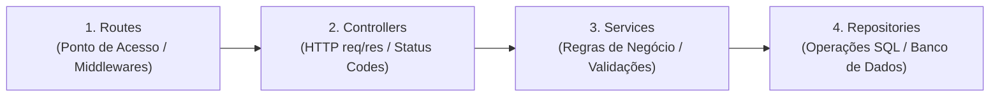

# Diretrizes e Regras Globais do Backend — OdontoFlow

> **Status:** Documento Vivo de Referência Obrigatória  
> **Localização:** `docs/backend/funcionalidades/regras_globais.md`  
> **Público-alvo:** Agentes de IA e Desenvolvedores Backend  
> **Objetivo:** Estabelecer as fundações inegociáveis de persistência, segurança, integridade, arquitetura em camadas e estratégia de testes no backend da aplicação.

---

## 1. Soft-Delete Mandatório e Integridade Histórica

### 1.1 Princípio Fundamental
Nenhum registro de entidades de negócio (pacientes, procedimentos, agendamentos, transações financeiras, bloqueios de agenda, etc.) deve ser excluído fisicamente do banco de dados via comando SQL `DELETE FROM`.

A exclusão é estritamente **lógica (Soft Delete)**.

### 1.2 Justificativa de Negócio e Técnica
- **Rastreabilidade e Auditoria:** Preservação do prontuário, histórico clínico e registros de atendimentos realizados.
- **Integridade Contábil e Financeira:** Transações financeiras passadas e relatórios de faturamento não podem sofrer distorções ou quebras de chave estrangeira decorrentes da exclusão de um paciente ou procedimento.
- **Recuperabilidade:** Facilidade de restauração de dados em caso de exclusão acidental pelo usuário.

### 1.3 Estrutura Padrão nas Tabelas
As tabelas que suportam soft-delete contêm os seguintes campos de controle:
- `is_active BOOLEAN DEFAULT TRUE`: Flag de status operacional.
- `deleted_at TIMESTAMP WITH TIME ZONE DEFAULT NULL`: Marcação temporal do momento da exclusão lógica.
- `updated_at TIMESTAMP WITH TIME ZONE DEFAULT CURRENT_TIMESTAMP`: Registro de última alteração.

### 1.4 Regras de Implementação nos Repositórios
1. **Operação de Exclusão:**
   ```sql
   UPDATE <tabela>
   SET is_active = false,
       deleted_at = CURRENT_TIMESTAMP,
       updated_at = CURRENT_TIMESTAMP
   WHERE id = $1 AND tenant_id = $2 AND deleted_at IS NULL;
   ```
2. **Consultas Operacionais do Dia a Dia (`findAll`, `findById`, buscas):**
   - Devem conter obrigatoriamente a cláusula `AND deleted_at IS NULL`.
   - Filtros adicionais de registros ativos (`AND is_active = true`) aplicam-se conforme o escopo da listagem (ex.: formulários de seleção de procedimentos ativos).
3. **Consultas Analíticas e Auditoria:**
   - Módulos de relatórios históricos e métricas passadas podem incluir registros onde `deleted_at IS NOT NULL`, desde que façam parte do consolidado histórico do período correspondente.
4. **Proibição Estrita:**
   - É terminantemente proibido o uso de `DELETE FROM <table>` no código de produção para entidades de negócio. Exceções aplicam-se apenas a tabelas de cache temporário ou sessões efêmeras sem valor histórico.

---

## 2. Isolamento Estrito Multi-Tenant (Tenant Scoping)

### 2.1 Princípio Fundamental
O sistema adota a arquitetura de **Banco Compartilhado com Esquema Compartilhado (Shared Database, Shared Schema)**. Portanto, o isolamento entre consultórios/clínicas (`tenants`) é o pilar de segurança número 1. 

Nenhuma informação de um consultório pode, sob qualquer circunstância, ser consultada, modificada ou vazada para outro consultório (*Cross-Tenant Data Leakage*).

### 2.2 Camada de Autenticação e Contexto de Requisição
1. **Origem da Identidade:**
   - O identificador do consultório (`tenantId`) é extraído com segurança via `authMiddleware` através de JWT assinado (`req.tenantId`) ou token de integração validado.
   - NUNCA confie no `tenant_id` enviado no corpo da requisição (`req.body`) ou em parâmetros de rota sem confrontar com `req.tenantId`.
2. **Atribuição em Criação (`INSERT`):**
   - Ao persistir novos registros, o campo `tenant_id` deve ser preenchido explicitamente com o valor oriundo do token autenticado (`req.tenantId`).

### 2.3 Camada de Repositório e Consultas SQL
1. **Cláusula Composta Obrigatória:**
   - Todas as consultas por ID específico (`findById`, `update`, `softDelete`) DEVEM combinar o `id` da entidade com o `tenant_id`:
     ```sql
     -- CORRETO:
     SELECT * FROM patients WHERE id = $1 AND tenant_id = $2 AND deleted_at IS NULL;

     -- INCORRETO (Vulnerabilidade de IDOR / Vazamento):
     SELECT * FROM patients WHERE id = $1;
     ```
2. **Listagens Gerais (`findAll`):**
   - A primeira condição do filtro deve ser sempre `WHERE tenant_id = $1`.
3. **Validação de Chaves Estrangeiras Cruzadas:**
   - Ao criar ou atualizar registros relacionados (ex.: vincular um `patient_id` ou `procedure_id` a um novo agendamento), o sistema deve validar se esses registros referenciados também pertencem ao mesmo `tenant_id`.

---

## 3. Arquitetura em Camadas (Routes ➔ Controllers ➔ Services ➔ Repositories)

Para garantir desacoplamento, organização, manutenibilidade e alta testabilidade, o backend adota rigorosamente a divisão em 4 camadas bem delimitadas:



### 3.1 Responsabilidades por Camada

| Camada | Pasta | Responsabilidade Principal | O que NÃO deve fazer |
| :--- | :--- | :--- | :--- |
| **Routes** | `backend/src/routes/` | Ponto de entrada da API HTTP. Define os endpoints, verbos HTTP (GET, POST, PUT, DELETE) e anexa middlewares (ex.: `authMiddleware`). | **Não** contém lógica de negócio, **não** trata requisições diretamente e **não** chama repositórios. |
| **Controllers** | `backend/src/controllers/` | Recebe a requisição HTTP (`req`), extrai e valida parâmetros de entrada (`params`, `query`, `body`, `tenantId`), repassa para o Service correspondente e envia a resposta HTTP (`res.status(...).json(...)`). | **Não** executa queries SQL no banco e **não** implementa regras de negócio pesadas. |
| **Services** | `backend/src/services/` | Coração das **Regras de Negócio**. Valida fluxos de domínio, conflitos de horário, regras de faturamento, orquestra múltiplos repositórios ou serviços externos (ex.: BullMQ, Evolution API). | **Não** acessa objetos Express (`req`, `res`), **não** manipula status codes HTTP diretamente e **não** escreve queries SQL diretas. |
| **Repositories** | `backend/src/repositories/` | Camada de **Persistência de Dados**. Executa exclusivamente queries SQL no PostgreSQL (`pg`), aplicando filtros obrigatórios de `tenant_id`, `deleted_at IS NULL`, paginação e ordenação. | **Não** toma decisões de regras de negócio de alto nível e **não** conhece o contexto HTTP. |

---

## 4. Estratégia de Testes Unitários e Isolados por Camada

Cada camada deve possuir seus testes unitários focados, permitindo identificar com precisão a origem de qualquer regressão ou falha:

### 4.1 Testes Unitários de Repositório (`*.repository.spec.ts`)
- **Foco:** Validar se os comandos SQL funcionam corretamente e se as garantias de persistência são cumpridas.
- **O que testar:**
  - Isolamento multi-tenant: registros de um `tenant_id` não são retornados para outro.
  - Soft-delete: registros marcados com `deleted_at` não aparecem em buscas padrão.
  - Filtros de busca, paginação e ordenação SQL.
  - Banco em memória (`pg-mem`) ou banco de teste real para validar sintaxe SQL pura.

### 4.2 Testes Unitários de Service (`*.service.spec.ts`)
- **Foco:** Validar as regras de negócio de forma 100% isolada e rápida.
- **O que testar:**
  - Validações de domínio (ex.: impedir agendamento em horário já ocupado, bloqueio de valores negativos).
  - Lançamento de exceções de negócio (erros específicos com mensagens claras).
  - Orquestração: verificar se os métodos do repositório foram chamados com os parâmetros corretos.
  - **Mocks:** Os repositórios e serviços externos devem ser mockados (ex.: via `vi.fn()` ou instâncias mockadas), sem dependência de banco de dados.

### 4.3 Testes Unitários de Controller (`*.controller.spec.ts`)
- **Foco:** Validar o contrato HTTP e a correta intermediação com o Service.
- **O que testar:**
  - Extração correta de dados de `req.body`, `req.params`, `req.query` e `req.tenantId`.
  - Códigos de status HTTP retornados (ex.: 200 para sucesso, 201 para criação, 400 para entrada inválida, 404 para não encontrado).
  - Resposta a exceções: verificar se os erros lançados pelo Service são convertidos nas respostas HTTP esperadas.
  - **Mocks:** O Service deve ser mockado.

### 4.4 Testes de Rotas e Integração (`*.routes.spec.ts`)
- **Foco:** Validar a integração da API via chamadas HTTP completas utilizando `supertest`.
- **O que testar:**
  - Proteção por middleware: rejeição de chamadas sem token (401).
  - Respostas ponta a ponta dos endpoints.

---

## 5. Padrões de Execução SQL e Concorrência

1. **Parametrização Estrita:**
   - Toda consulta via driver `pg` deve usar exclusivamente parâmetros posicionais (`$1, $2, ...`). É vedada a concatenação de strings ou *template literals* em cláusulas SQL para evitar *SQL Injection*.
2. **Datas e Fusos Horários:**
   - O armazenamento no PostgreSQL é padronizado em UTC (`TIMESTAMP WITH TIME ZONE`).
   - Relatórios e agrupamentos diários devem converter o fuso explicitamente para a timezone local da clínica (ex.: `AT TIME ZONE 'America/Sao_Paulo'`).

---

---

## 7. Autenticação, Gestão de Usuários e Segurança de Identidade

### 7.1 Criação de Contas Exclusiva por Linha de Comando (CLI)
- **Zero Cadastro Aberto:** Não existem e é terminantemente proibido criar endpoints públicos de registro (`/api/auth/register`, `/api/auth/signup`).
- O provisionamento de novos consultórios e seus titulares é feito **exclusivamente pelo desenvolvedor** através do CLI:
  ```bash
  npm run user:create -- --name "Nome do Consultório" --email "contato@clinica.com" [--password "opcional"]
  ```
- Caso nenhuma senha seja informada, o sistema gera automaticamente uma senha temporária aleatória segura de 16 caracteres e marca a flag `must_change_password = true`.

### 7.2 Hashing e Política de Senhas com Bcrypt
- **Algoritmo Obrigatório:** Todas as senhas são armazenadas como hash seguro via `bcrypt` com fator de custo (salt rounds) padronizado em **10**.
- **Proibição de Texto Puro:** Nunca armazene ou compare senhas em texto puro no banco de dados.
- **Proteção contra Comparação de Hash:** A camada de verificação (`PasswordService.verifyPassword`) rejeita senhas cujo texto puro seja idêntico ao hash armazenado (prevenção contra vazamento de hash em trânsito).
- **Política Mínima de Senhas:**
  - Mínimo de 8 caracteres;
  - Ao menos 1 letra;
  - Ao menos 1 número;
  - Obrigação de ser diferente da senha atual na troca.

### 7.3 Recuperação e Reset de Senha pelo Desenvolvedor
- O cliente não possui fluxo de recuperação pública autônoma (ex.: "esqueci minha senha" público).
- A recuperação é conduzida pelo desenvolvedor via CLI administrativo:
  ```bash
  npm run user:reset-password -- --email "contato@clinica.com"
  ```
- O comando gera uma senha temporária aleatória de 16 caracteres, atualiza o hash no PostgreSQL, ativa `must_change_password = true`, incrementa o `token_version` e imprime a credencial temporária uma única vez no console.

### 7.4 Troca Autenticada de Senha pelo Cliente e Invalidação de Sessão
- O cliente logado pode alterar sua senha a qualquer momento através do endpoint `POST /api/auth/change-password`.
- **Invalidação Instantânea de Sessões Anteriores:** Toda troca de senha ou reset administrativo incrementa atomicamente a coluna `token_version` do consultório. Qualquer token JWT emitido com `tv` inferior torna-se imediatamente inválido em todas as rotas protegidas (HTTP 401).

### 7.5 Bloqueio Estrito sob Flag `must_change_password` (HTTP 403)
- Usuários com `must_change_password = true` são restritos pelo `authMiddleware`:
  - **Acesso Permitido:** Apenas rotas de consulta de perfil (`GET /api/auth/me`) e troca de senha (`POST /api/auth/change-password`).
  - **Bloqueio em Rotas de Negócio:** Qualquer tentativa de acessar pacientes, agendamentos, financeiro ou relatórios retorna imediatamente `HTTP 403 Forbidden` com código de erro `PASSWORD_CHANGE_REQUIRED`.

### 7.6 Proibição de Bypass por Cabeçalho (`x-tenant-id`)
- É vedada a autenticação ou determinação de tenant baseada em cabeçalhos não assinados como `x-tenant-id`.
- Todas as requisições autenticadas DEVEM conter o cabeçalho `Authorization: Bearer <token_jwt>`.

### 7.7 Proteção contra Força Bruta no Login (Rate Limiting)
- O endpoint `POST /api/auth/login` é protegido por rate limiter:
  - Limite de **5 tentativas incorretas** por combinação de IP e e-mail em uma janela deslizante de **15 minutos**.
  - Após 5 falhas, requisições subsequentes são bloqueadas com `HTTP 429 Too Many Requests`.
  - Respostas de credenciais inválidas utilizam mensagem genérica padronizada: `"Credenciais inválidas ou acesso não autorizado."`.

---

## 8. Checklist para Novas Implementações e Refatorações

Antes de considerar qualquer nova funcionalidade ou rota concluída, verifique:
- [ ] A rota está registrada em `routes/` apenas mapeando o endpoint, middlewares e o método do Controller?
- [ ] O Controller apenas processa `req`/`res` e delega a lógica para o Service?
- [ ] O Service concentra todas as regras de negócio e validações, sem depender de `req` ou `res`?
- [ ] O Repository é o único que contém queries SQL, filtrando estritamente `tenant_id = $x` e `deleted_at IS NULL`?
- [ ] A exclusão é feita via Soft-Delete (`UPDATE ... SET deleted_at = CURRENT_TIMESTAMP`)?
- [ ] Toda rota protegida exige `Authorization: Bearer <token>` (sem bypass de `x-tenant-id`)?
- [ ] Existem testes unitários para o Repository cobrindo persistência, soft-delete e isolamento multi-tenant?
- [ ] Existem testes unitários para o Service com mocks do Repository cobrindo as regras de negócio?
- [ ] Existem testes unitários para o Controller cobrindo os status codes e tratamento de requisições?
- [ ] Existem testes de rota via Supertest validando a autenticação e integração?

